# AguaJusta Oeste — Distribución Justa, Explicable y Auditable de Cisternas en Panamá Oeste

Reto: 1

## Equipo

- Joaquín Porsella (@porsellaj)
- Edward Sparks (@EdwardSparks)
- Franz Vera (@Meowty7)

## Problema

En Panamá Oeste (Arraiján y La Chorrera), los reportes de falta de agua llegan fragmentados, duplicados y sesgados por visibilidad en redes o canales informales. Quien más se queja suele recibir atención antes que quien tiene mayor urgencia real. **AguaJusta Oeste** convierte reportes desordenados en un plan de despacho de cisternas determinístico, explicable y sujeto a aprobación humana obligatoria, donde **el volumen de quejas repetidas nunca altera el puntaje de prioridad (`report_count` invariante)**.

## Arquitectura de agentes

El flujo está orquestado de forma secuencial en `src/orchestration/agent.py`, sobre **pydantic-ai**, con contratos estrictos en `src/contracts.py` y límites de uso (`UsageLimits`). Tres agentes con roles distintos procesan los reportes; ninguno aprueba el plan final.

### Agente 1 — Ingesta (`src/ingestion/agent.py`)

Extrae sector candidato, horas sin agua, personas afectadas, banderas de vulnerabilidad (`HOSPITAL_SALUD`, `ESCUELA`, `ADULTOS_MAYORES`, `INFANTES`, `ALBERGUE`), evidencia e incertidumbre. Antes del LLM, **guardrails determinísticos** (`src/ingestion/guardrails.py`) rechazan o marcan para revisión entradas vacías, maliciosas (prompt injection), absurdas (>720 h o >100 000 personas) o fuera de Panamá Oeste. **No inventa** ubicación, afectados ni duración faltantes.

### Deduplicador geográfico determinístico

`src/ingestion/deduplicator.py` + `src/ingestion/geolocator.py` resuelven **15 anclas** en `data/fixtures/places_panama_oeste.json` y coordenadas con distancia **Haversine** (umbral **800 m**). Incidentes del mismo sector a más de 800 m (p. ej. Chino y Xtra de Vista Alegre) permanecen **separados**. Menciones solo a nivel de sector se retienen para revisión si ya existe un punto concreto en ese sector.

### Agente 2 — Evaluación y priorización

`src/prioritization/agent.py` analiza contexto cualitativo e invoca la herramienta determinística `score_cluster_tool` implementada en `src/priority.py` (**`priority-v1`**: 0–100 pts = horas 0–40 + afectados 0–30 + vulnerabilidad 0–30). El LLM **nunca** decide ni modifica números.

### Agente 3 — Planificación

`src/planner/agent.py` invoca `solve_assignment` en `src/planner/solver.py` con **Google OR-Tools** (`RoutingModel`: capacidad en litros, ventana de turno de 480 min, penalizaciones por disyunción ponderadas por prioridad cuando la demanda supera la flota).

### Compuerta de supervisión humana

`src/coordinator/service.py` + `src/coordinator/store.py` implementan la máquina de estados:

`BORRADOR` → `PENDIENTE` → `APROBADO` / `RECHAZADO`, o regreso a `BORRADOR` vía `CORRECT`.

Ningún agente aprueba planes. Solo tras **`APPROVE`** se persiste en SQLite y se encolan avisos en la bandeja **`SIMULATED`** (`src/communication/outbox.py`).

### Diagrama del pipeline

```mermaid
flowchart LR
    subgraph Entrada
        C["/ciudadano<br/>Portal ciudadano"]
        A["/admin<br/>Centro de coordinación"]
    end

    C --> API["POST /api/citizen-report<br/>POST /api/reports"]
    A --> API2["POST /api/preload<br/>POST /api/reports"]

    API --> ORCH["orchestrate<br/>src/orchestration/agent.py"]
    API2 --> ORCH

    ORCH --> AG1["Agente 1 — Ingesta<br/>ingest_report + guardrails"]
    AG1 --> DED["Deduplicador Haversine 800 m<br/>deduplicate_reports"]
    DED --> AG2["Agente 2 — Evaluación<br/>prioritize_clusters + priority-v1"]
    AG2 --> AG3["Agente 3 — Planificación<br/>plan_assignment + OR-Tools"]
    AG3 --> BOR["Plan BORRADOR"]

    BOR --> REV["submit_for_review → PENDIENTE"]
    REV --> HUM{"Compuerta humana<br/>APPROVE / REJECT / CORRECT"}

    HUM -->|APPROVE| SQL["SQLite transaccional<br/>plan + auditoría"]
    SQL --> OUT["Outbox SIMULATED<br/>src/communication/outbox.py"]
    OUT --> OK["APROBADO"]

    HUM -->|REJECT| AUD["Solo auditoría"]
    AUD --> NO["RECHAZADO"]

    HUM -->|CORRECT| BOR
```



## Tecnologías y fuentes de datos

| Componente | Tecnología |
|------------|------------|
| Runtime | Python 3.12+ |
| Contratos y validación | `pydantic` v2, `extra="forbid"` |
| Agentes | `pydantic-ai`, `UsageLimits` |
| Asignación y rutas | `ortools` 9.15 (`RoutingModel`) |
| Persistencia | SQLite transaccional (`BEGIN IMMEDIATE`) |
| Servidor HTTP | `ThreadingHTTPServer` (stdlib) |
| Mapa | Leaflet + Leaflet.heat + respaldo SVG offline |

**Etiquetas de procedencia obligatorias:** `SYNTHETIC_DEMO`, `ASSUMPTION`, `OFFICIAL_SOURCE`.

Detalle de fixtures, anclas y límites de datos: [`docs/FUENTES_Y_DATOS.md`](docs/FUENTES_Y_DATOS.md).

**Límites explícitos del prototipo:**

1. Los avisos a residentes se encolan únicamente en la bandeja **`SIMULATED`** en SQLite; **no** se envían mensajes de WhatsApp a ciudadanos (opcionalmente un aviso de prueba al número del equipo si hay credenciales en `.env`).
2. Un sector con **cero reportes** permanece invisible para el despacho automático salvo que el coordinador ingrese un reporte; la UI lo muestra bajo *Sectores silenciosos*.
3. Los pesos de `priority-v1`, la dotación de 15 L/persona y la flota de 3 cisternas son **`ASSUMPTION`** de prototipo, no política oficial del IDAAN.

## Instalación y ejecución

```bash
python -m venv .venv
.venv/bin/pip install -r requirements.txt
cp .env.example .env
```

Variables en `.env.example` (placeholders; **`MODO=test`** por defecto):

| Variable | Uso |
|----------|-----|
| `MODO` | `test` (determinístico) o `live` (API real) |
| `MODEL_NAME` | Modelo para agentes en modo live |
| `GOOGLE_API_KEY`, `OPENAI_API_KEY`, `ANTHROPIC_API_KEY` | Proveedores LLM (solo modo live) |
| `WHATSAPP_TOKEN`, `WHATSAPP_PHONE_NUMBER_ID`, `WHATSAPP_TO` | Aviso opcional al equipo tras `APPROVE` |

Arranque del servidor:

```bash
MODO=test .venv/bin/python -m src.coordinator.app
```

Base: `http://127.0.0.1:8000/`

| Ruta | Descripción |
|------|-------------|
| `/ciudadano` | Portal ciudadano (asistente, GPS, trazas de agentes) |
| `/admin` | Centro de coordinación (mapa, prioridad, aprobación) |
| `GET /api/health` | Estado del servicio |
| `GET /api/context` | Snapshot para la UI |
| `POST /api/preload` | Precarga fixtures de demo |
| `POST /api/citizen-report` | Reporte desde portal ciudadano |
| `POST /api/reports` | Pipeline completo vía orquestador |
| `POST /api/review` | Enviar plan a revisión (`PENDIENTE`) |
| `POST /api/decision` | Decisión humana (`APPROVE` / `REJECT` / `CORRECT`) |
| `POST /api/reset` | Reinicio de sesión de demo |

## Evals

Tres suites determinísticas (**44 casos**, ejecutadas en **`MODO=test`**) más **177 pruebas unitarias**.

### Suite de ingesta (18 casos)

```bash
MODO=test .venv/bin/python -m evals.eval_ingestion
```

Salida: `evals/results_ingestion.json`

| Métrica | Resultado |
|---------|-----------|
| `sector_accuracy` | 1.0 |
| `guardrail_accuracy` | 1.0 |
| `no_hallucination_rate` | 1.0 |
| `review_flag_accuracy` | 1.0 |
| `deduplication_accuracy` | 1.0 |

### Suite de asignación y prioridad (16 casos)

```bash
MODO=test .venv/bin/python -m evals.eval_allocation
```

Salida: `evals/results_allocation.json`

| Métrica | Resultado |
|---------|-----------|
| `case_accuracy` | 1.0 |
| `priority_order_accuracy` | 1.0 |
| `volume_invariance_rate` | 1.0 |
| `constraint_compliance_rate` | 1.0 |
| `demand_coverage_accuracy` | 1.0 |

### Suite de supervisión humana (10 casos)

```bash
MODO=test .venv/bin/python -m evals.eval_supervision
```

Salida: `evals/results_supervision.json`

| Métrica | Resultado |
|---------|-----------|
| `case_accuracy` | 1.0 |
| `dispatches_without_approve` | 0 |

### Pruebas unitarias

```bash
TMP=/tmp MODO=test .venv/bin/python -m unittest discover -s tests -v
```

**177** pruebas OK (verificar en cada corrida).

## Bitácora de IA

Con asistencia de IA (Cursor, Claude y agentes de código) se construyeron: contratos Pydantic compartidos, tres agentes en **`MODO=test`** con `FunctionModel` reproducible, motor **`priority-v1`**, integración **OR-Tools**, orquestador secuencial, portal dual v10 (`/ciudadano` + `/admin`) y las tres suites de evals (44 casos).

**Auditado y corregido manualmente por el equipo:**

- Separación de incidentes a **>800 m** en Vista Alegre (Chino vs Xtra).
- Retención de menciones de sector ambiguas cuando ya hay punto concreto.
- Disyunciones ponderadas en OR-Tools para lotes con sobrecupo de demanda.
- Limpieza de **event loops** en hilos (Python 3.14) en `src/orchestration/agent.py`.
- Bloqueo de outbox hasta **`APPROVE`**; paridad de IDs HTML/JS en el panel.

Metodología detallada y registro por componente: [`docs/METODOLOGIA_Y_BITACORA_IA.md`](docs/METODOLOGIA_Y_BITACORA_IA.md). Diagrama de supervisión: [`docs/diagrama_supervision.md`](docs/diagrama_supervision.md).

---

Entrega: tag de git `final-24h` sobre el último commit válido, al cumplirse la hora 24.
