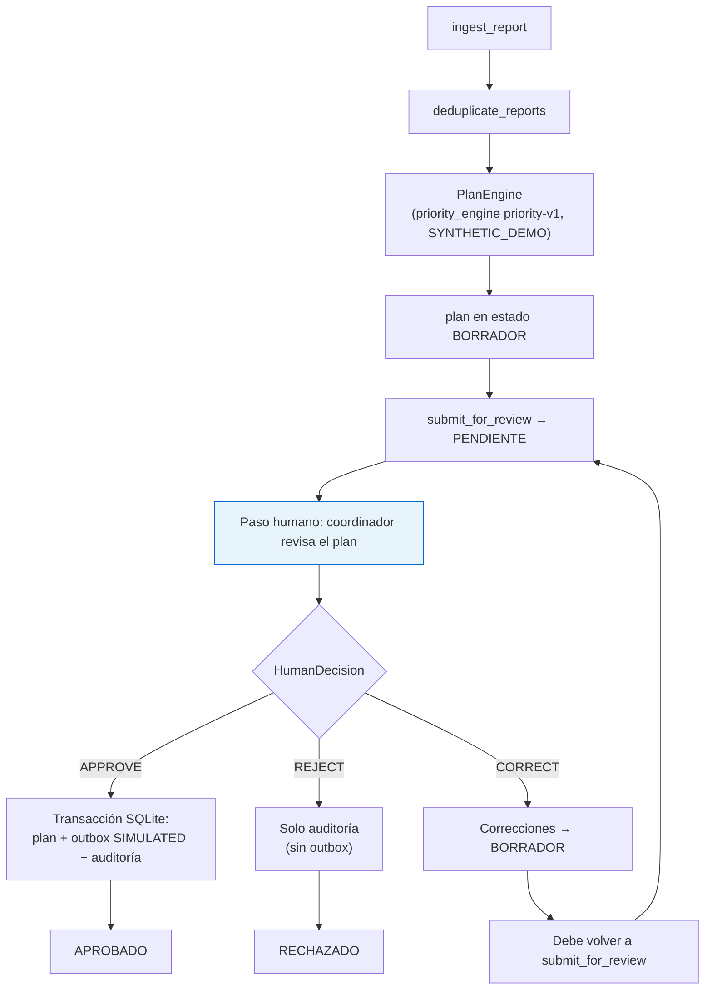

# Flujo de supervisión humana

El coordinador revisa el borrador del plan (prioridades y rutas con motor de demostración), puede corregir datos, y solo con **APROBAR** se persiste el despacho y se encola la outbox **simulada** (no es WhatsApp ni un canal real). Rechazar deja traza de auditoría sin notificaciones.

Ninguna rama escribe en la outbox sin una decisión **APPROVE**. Los pesos de prioridad y el solver mostrados aquí son stub de demostración, no política oficial del IDAAN.
