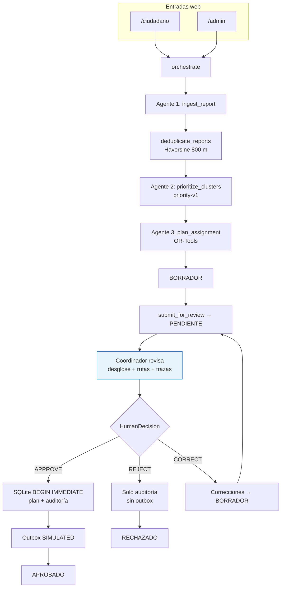

# Flujo de supervisión humana y pipeline completo

AguaJusta Oeste ejecuta el pipeline multiagente **antes** de mostrar el borrador al coordinador. Ningún paso escribe avisos a residentes hasta una decisión humana **`APPROVE`**. Los pesos `priority-v1`, la flota y OR-Tools son parámetros de prototipo (`ASSUMPTION`), no política oficial del IDAAN.

## Pipeline operativo

1. **`orchestrate`** (`src/orchestration/agent.py`) — secuencia determinística tras `POST /api/reports` o flujos equivalentes.
2. **Agente 1 — `ingest_report`** — extracción + guardrails (`src/ingestion/agent.py`, `src/ingestion/guardrails.py`).
3. **`deduplicate_reports`** — geolocalización y Haversine **800 m** (`src/ingestion/deduplicator.py`, `src/ingestion/geolocator.py`).
4. **Agente 2 — `prioritize_clusters`** — contexto cualitativo + **`priority-v1`** vía `score_cluster_tool` (`src/prioritization/agent.py`, `src/priority.py`).
5. **Agente 3 — `plan_assignment`** — **`solve_assignment`** con **OR-Tools** (`src/planner/agent.py`, `src/planner/solver.py`).
6. Plan en estado **`BORRADOR`** → **`submit_for_review`** → **`PENDIENTE`**.
7. **Compuerta humana** — `APPROVE` / `REJECT` / `CORRECT` (`src/coordinator/service.py`).
8. Solo **`APPROVE`**: transacción SQLite (plan + auditoría) + outbox **`SIMULATED`** (`src/communication/outbox.py`).

Entradas de UI: **`/ciudadano`** (reportes ciudadanos) y **`/admin`** (precarga, revisión, mapa, trazas).

## Reglas de la compuerta

| Decisión | Persistencia de plan | Outbox `SIMULATED` | Estado final |
|----------|----------------------|--------------------|--------------|
| `APPROVE` | Sí | Sí (por sector asignado / no atendido) | `APROBADO` |
| `REJECT` | Traza de auditoría | No | `RECHAZADO` |
| `CORRECT` | Actualiza borrador | No (hasta nuevo APPROVE) | `BORRADOR` → reenvío a `PENDIENTE` |

**Invariante:** `dispatches_without_approve = 0` (ver `evals/eval_supervision.py`).

## Qué no hace este flujo

- No envía WhatsApp a números de reportes ciudadanos.
- No consulta averías en tiempo real del IDAAN.
- No trata el volumen de quejas repetidas como factor de prioridad (`report_count` invariante).
